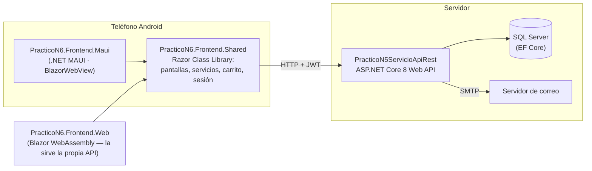
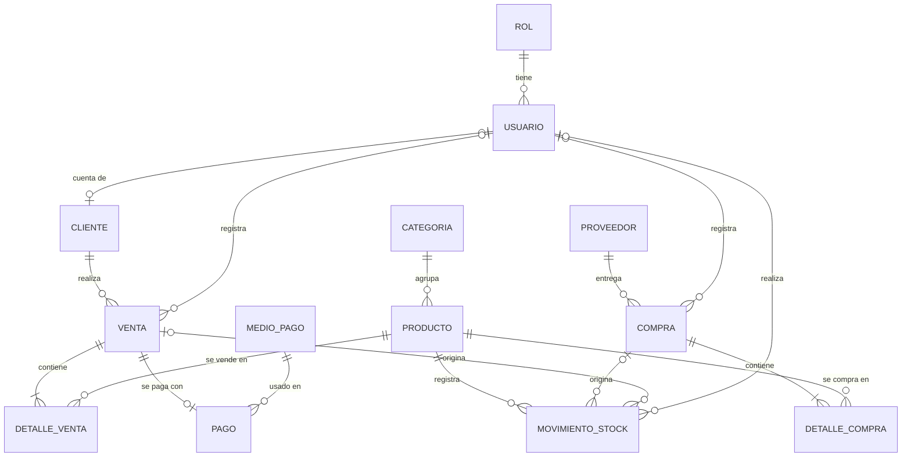

# Tienda Móvil — TP 6 (Programación Móvil)

Sistema de ventas y control de stock con **backend ASP.NET Core Web API** (TP 5) y un **frontend móvil en Blazor Hybrid (.NET MAUI)** para Android: catálogo de productos, carrito de compras, pago simulado, registro de entradas de mercadería, reportes en PDF, control de acceso por roles y registro de auditoría y de errores.

> Este repositorio parte del TP 5 ([`PracticoN5ServicioApiRest`](https://github.com/Francisco-bascal/PracticoN5ServicioApiRest)) y lo extiende para cumplir las consignas del TP 6.

---

## Índice

1. [Cumplimiento de las consignas](#cumplimiento-de-las-consignas)
2. [Arquitectura](#arquitectura)
3. [Interfaz y convenciones de frontend](#interfaz-y-convenciones-de-frontend)
4. [Estructura del repositorio](#estructura-del-repositorio)
5. [Cómo ejecutarlo](#cómo-ejecutarlo)
6. [Usuarios de ejemplo](#usuarios-de-ejemplo)
7. [Roles y permisos](#roles-y-permisos)
8. [Modelo de datos y normalización](#modelo-de-datos-y-normalización)
9. [Endpoints de la API](#endpoints-de-la-api)
10. [Flujos de negocio](#flujos-de-negocio)
11. [Auditoría y registro de errores](#auditoría-y-registro-de-errores)
12. [Configuración](#configuración)
13. [Pruebas y qué se verificó](#pruebas-y-qué-se-verificó)
14. [Trabajo en equipo y Git](#trabajo-en-equipo-y-git)
15. [Limitaciones y mejoras posibles](#limitaciones-y-mejoras-posibles)

---

## Cumplimiento de las consignas

| Consigna del TP 6 | Cómo se cumple | Dónde |
|---|---|---|
| Frontend con **Blazor Hybrid** vinculado al backend del TP 5, probado en **Android** | App .NET MAUI con `BlazorWebView` que consume la API REST por HTTP/JWT. Objetivo de compilación: `net8.0-android`. | `PracticoN6.Frontend.Maui`, `PracticoN6.Frontend.Shared` |
| **Catálogo de productos** (tipo mercado libre) y **carrito de compras** | Grilla de productos con imagen, búsqueda, filtro por categoría, hoja inferior para ordenar por nombre/precio y mostrar "solo con stock", y paginación; detalle de producto; carrito persistente por usuario. | `Pages/Catalogo.razor`, `ProductoDetalle.razor`, `CarritoPagina.razor` |
| Registrar **ventas** y **entradas de mercadería**, con **control de stock** actualizado | Las ventas se registran desde el carrito (checkout) o como venta de mostrador; las entradas, como compras a proveedores. Cada cambio de stock queda en un **libro de movimientos** y se aplica con un `UPDATE` condicional en la base, pensado para que dos operaciones simultáneas no puedan dejar el stock negativo (las pruebas cubren la última unidad de forma secuencial; no hay una prueba de concurrencia real). | `MovimientosStockService`, `VentasService`, `ComprasService` |
| Ver el catálogo con **disponibilidad y stock** | Cada producto muestra "Stock: N", "¡Últimas N unidades!" o "Sin stock" (botón deshabilitado). | `InsigniaStock.razor`, `TarjetaProducto.razor` |
| **Compra y pago simulado** | Checkout con medio de pago (crédito, débito, transferencia) y pasarela simulada: aprueba con código de autorización o rechaza (HTTP 402). Stock, venta y pago se confirman **en una sola transacción**. | `Checkout.razor`, `PasarelaPagoSimulada`, `VentasService.CheckoutAsync` |
| **Reportes en PDF** para consulta y **envío por correo** (stock, entradas, salidas…) | Reportes de stock, entradas, salidas, movimientos y comprobante de venta. Se ven/guardan/comparten desde el teléfono o se envían por correo (SMTP). | `ReportesController`, `ReportesPdfService`, `EmailService`, `AdminReportes.razor` |
| **Control de acceso y gestión de roles** | JWT con roles `Administrador`, `Operador` y `Cliente` (tabla propia); pantallas y endpoints restringidos por rol; el administrador asigna roles, activa/desactiva y elimina usuarios. | [Roles y permisos](#roles-y-permisos), `AdminUsuarios.razor` |
| **Auditoría y registro (log) de errores** | Toda acción que modifica datos, cada login (exitoso o fallido) y cada reporte generado quedan auditados (quién, qué, cuándo, resultado). Los errores no controlados del servidor y de la app se guardan con su detalle técnico. | [Auditoría y registro de errores](#auditoría-y-registro-de-errores) |
| Trabajo en **grupos de 2** y repositorio **Git** | Ver [Trabajo en equipo y Git](#trabajo-en-equipo-y-git). | — |
| **Normalización** de la base de datos (al menos 3FN) | Modelo en 3FN con análisis y decisiones explícitas (incluida la única desnormalización deliberada). | [Modelo de datos y normalización](#modelo-de-datos-y-normalización) |

---

## Arquitectura



- **Backend**: `Controller → Service → DbContext (EF Core) → SQL Server`. Los servicios concentran la lógica y las transacciones; los controllers solo resuelven HTTP y roles.
- **Frontend**: toda la interfaz y la lógica viven en una **Razor Class Library compartida**. La app MAUI es un *host* mínimo que aporta lo propio del dispositivo (almacenamiento cifrado del token, hoja de compartir de Android, permisos). El mismo código corre en el navegador (`PracticoN6.Frontend.Web`) para desarrollar y probar sin emulador.
- Lo que depende de la plataforma se aísla en cinco interfaces (`IAlmacenamientoSeguro`, `IPreferencias`, `IGestorArchivos`, `IConectividad`, `ICompartir`) que cada host implementa: en Android usan `SecureStorage`, `Connectivity` y la hoja de compartir del sistema; en el navegador, `localStorage`, `navigator.onLine` y `navigator.share` (o el portapapeles).

---

## Interfaz y convenciones de frontend

La interfaz se rehízo siguiendo dos *skills* de desarrollo frontend (`.claude/skills/`): `frontend-core` (convenciones generales) y `blazor-hybrid`, que es la `blazor-webapp` original adaptada a Blazor Hybrid con .NET MAUI (no hay *render modes* ni prerenderizado: todo es interactivo y corre en el dispositivo).

- **Bootstrap 5.3** como base de estilos, incluido en el repositorio (`wwwroot/lib`, sin CDN: la app debe funcionar sin internet en el teléfono) junto con **Bootstrap Icons**. No se usa el JavaScript de Bootstrap: los modales, avisos (*toast*) y la hoja de filtros (*offcanvas*) usan solo sus clases CSS y el estado de Blazor. `wwwroot/css/app.css` contiene únicamente lo que Bootstrap no resuelve (marca, barra de pestañas, áreas seguras del teléfono, ajustes táctiles).
- **Móvil primero**: navegación por pestañas inferiores, controles de al menos 44 px, teclados adecuados (`inputmode`, `autocomplete`), barras de acción fijas para "Pagar" y "Registrar", respeto de las áreas seguras (muesca y barra de gestos) y **modo oscuro** automático según el teléfono.
- **Componentes reutilizables** con `[Parameter]` y *callbacks* (`Components/`): `EstadoVista` (resuelve los cuatro estados de toda lista: cargando, error con *Reintentar*, vacío y con datos), `EncabezadoPagina`, `Alerta`, `Paginador`, `TarjetaProducto`, `ImagenProducto`, `InsigniaStock`, `SelectorCantidad`, `DialogoConfirmacion`, `Notificaciones`, `EntradaPassword`, `AtajoPanel`, `EnlaceTab` y `ConectividadAviso` (franja "sin conexión").
- **Formularios** con `EditForm`, Data Annotations y `ValidacionBootstrap` (marca el campo inválido con `is-invalid` y muestra el mensaje junto a él); los botones se deshabilitan mientras se envía para evitar envíos duplicados. El servidor vuelve a validar todo.
- **Accesibilidad**: HTML semántico, `label` en cada campo, `aria-label` en botones de ícono, `aria-current` en la pestaña activa, `aria-live` en avisos y foco al abrir los diálogos.
- Sin JavaScript para manipular el DOM: el pequeño `wwwroot/js/tienda.js` solo existe para el host web (descarga de archivos, `localStorage`, estado de red y compartir).
---

## Estructura del repositorio

```
PracticoN5ServicioApiRest.sln
├── PracticoN5ServicioApiRest/          API REST (TP 5 extendida)
│   ├── Controllers/                    endpoints HTTP
│   ├── Services/                       lógica de negocio, PDF, correo, stock, auditoría
│   ├── Models/  DTOs/  Data/           entidades, contratos, DbContext e inicializador
│   ├── Infraestructura/                filtro de auditoría y middleware de errores
│   ├── Migrations/                     migraciones EF Core (la nueva: Tp6BlazorHybrid)
│   ├── appsettings.Development.json   configuración de desarrollo lista para usar (SQLite)
│   └── appsettings.example.json        plantilla para SQL Server (copiar como appsettings.Local.json)
├── PracticoN5ServicioApiRest.Tests/    168 pruebas de integración de la API
├── PracticoN6.Frontend.Shared/         UI y lógica del frontend (Razor Class Library)
│   ├── Components/  Pages/  Layout/    componentes reutilizables, pantallas y estructura
│   ├── Services/  Models/              cliente HTTP, sesión, carrito, contratos de la API
│   └── wwwroot/                        Bootstrap y Bootstrap Icons (locales), app.css, tienda.js
├── PracticoN6.Frontend.Shared.Tests/   70 pruebas unitarias del frontend
├── PracticoN6.Frontend.Maui/           app Android (.NET MAUI + Blazor Hybrid)
├── PracticoN6.Frontend.Web/            host web (Blazor WebAssembly) para desarrollo y pruebas
├── e2e/                                recorridos automáticos de la interfaz (Playwright)
└── .claude/skills/                     convenciones de frontend (frontend-core y blazor-hybrid)
```

---

## Cómo ejecutarlo

### Requisitos

- **.NET 8 SDK** y **Visual Studio 2022 (17.8 o superior)** con la carga de trabajo *ASP.NET y desarrollo web*.
- Para la app en Android, además *Desarrollo de la interfaz de usuario de aplicaciones multiplataforma con .NET (MAUI)*, que incluye el SDK y el emulador de Android.
- **No hace falta instalar SQL Server para probarlo**: en desarrollo la API usa por defecto una base SQLite local. Para SQL Server, ver más abajo.

### Inicio rápido (ver la tienda en el navegador, sin emulador)

1. Abra `PracticoN5ServicioApiRest.sln` en Visual Studio.
2. Deje como proyecto de inicio **`PracticoN5ServicioApiRest`** (clic derecho → *Establecer como proyecto de inicio*) y presione **F5**.
3. Se abre el navegador en **http://localhost:5276/**: ahí está la tienda. La API y su documentación (Swagger) están en el mismo puerto: `http://localhost:5276/swagger`.
4. Ingrese con un [usuario de ejemplo](#usuarios-de-ejemplo), por ejemplo `cliente` / `Demo1234`.

La API sirve la tienda web (`PracticoN6.Frontend.Web`) ella misma, así que **alcanza con iniciar un solo proyecto**. Si no se abre nada, mire la ventana **Salida** / **Consola** de la API: ahí aparece el motivo (por ejemplo, un puerto ocupado). Por línea de comandos: `dotnet run --project PracticoN5ServicioApiRest`.

> La tienda web existe para desarrollar y probar sin emulador; la entrega del TP es la app Android (`PracticoN6.Frontend.Maui`), que usa las mismas pantallas.

### 1. La API

```bash
cd PracticoN5ServicioApiRest
dotnet run --launch-profile http        # http://localhost:5276/swagger
```

La configuración de desarrollo viene lista en `appsettings.Development.json` (base SQLite `tienda.db`, clave JWT de desarrollo, administrador inicial y datos de ejemplo). Al arrancar, la API crea las tablas, el **administrador inicial** y, si `Seed:DatosDemo` es `true`, un catálogo y usuarios de ejemplo.

**Usar SQL Server en lugar de SQLite:** copie `appsettings.example.json` como `appsettings.Local.json`, edite `ConnectionStrings:DefaultConnection` y ejecute de nuevo. Ese archivo **no se versiona** (es para sus datos personales: contraseñas, servidor) y pisa lo de `appsettings.Development.json`. Con SQL Server la API aplica las migraciones al arrancar (`Database:AplicarMigraciones`).

> No ponga secretos reales en `appsettings.Development.json`, que sí se versiona. En producción use `appsettings.Local.json`, variables de entorno o secretos de usuario (la clave JWT y la contraseña del administrador deben ser propias).

Migraciones a mano: el repositorio incluye `dotnet-tools.json` con `dotnet-ef` 10; con el SDK 8 instale la herramienta compatible (`dotnet tool install --global dotnet-ef --version 8.0.30`) y use `dotnet-ef database update`.

SQLite es para desarrollo y pruebas; el proveedor real del proyecto es SQL Server (la migración `Tp6BlazorHybrid` está pensada para él).

### 2. La app en Android

1. Abra `PracticoN5ServicioApiRest.sln` en Visual Studio y deje la API corriendo (paso 1).
2. Elija como proyecto de inicio **`PracticoN6.Frontend.Maui`**, un emulador Android (por ejemplo *Pixel 5 – API 34*) y ejecute.
3. Inicie sesión con un [usuario de ejemplo](#usuarios-de-ejemplo).

Por línea de comandos: `dotnet build PracticoN6.Frontend.Maui -t:Run -f net8.0-android`.

**Dirección de la API**

| Dónde corre la app | Dirección | Cómo configurarla |
|---|---|---|
| Emulador de Android | `http://10.0.2.2:5276` (la PC anfitriona) | Es la predeterminada |
| Teléfono real | `http://<IP de la PC>:5276` | Arrancar la API con `dotnet run --launch-profile http-lan`, permitir el puerto 5276 en el firewall y escribir la dirección en la pantalla **Servidor** de la app (se abre desde el login o desde *Cuenta*) |

En desarrollo la API usa **HTTP**, por eso el manifiesto de Android tiene `usesCleartextTraffic="true"` y la vista web permite contenido mixto (para las imágenes del catálogo). En producción conviene servir la API por HTTPS y quitar ambos ajustes.

### 3. La tienda web con su propio servidor (opcional)

Normalmente no hace falta: la API ya la sirve (ver *Inicio rápido*). Para desarrollar la interfaz con recarga rápida puede iniciarla aparte, con la API corriendo:

```bash
dotnet run --project PracticoN6.Frontend.Web      # http://localhost:5190
```

En Visual Studio, el perfil **«API + Web con servidor de desarrollo aparte»** (`PracticoN5ServicioApiRest.slnLaunch`, VS 17.11 o superior) inicia ambos proyectos. La dirección de la API que usa la tienda se cambia en `PracticoN6.Frontend.Web/wwwroot/appsettings.json` (o desde la pantalla **Servidor** de la propia app).

---

## Usuarios de ejemplo

Con `Seed:DatosDemo = true` (valor de la plantilla de configuración):

| Usuario | Contraseña | Rol |
|---|---|---|
| `admin` | `Admin1234` | Administrador |
| `operador` | `Demo1234` | Operador |
| `cliente` | `Demo1234` | Cliente |

**Pago simulado:** tarjeta `4242 4242 4242 4242` (cualquier número válido) → aprobado; número terminado en `0000` (por ejemplo `4000 0000 0000 0000`) → rechazado. No se realiza ningún cobro ni se guardan datos de tarjeta.

> Cambie estas contraseñas (o ponga `Seed:DatosDemo` en `false`) fuera de un entorno de pruebas.

---

## Roles y permisos

El registro público crea siempre un **Cliente**; los roles del personal los otorga un administrador (a diferencia del TP 5, donde el registro público daba permisos de operador).

| Recurso | Cliente | Operador | Administrador |
|---|:---:|:---:|:---:|
| Ver catálogo y categorías, usar el carrito, pagar | ✅ | ✅ | ✅ |
| Ver sus propios pedidos y comprobantes | ✅ | ✅ | ✅ |
| Alta y edición de productos, ajustes de stock, imágenes, categorías | — | ✅ | ✅ |
| Compras a proveedores (entradas), ventas y venta de mostrador, clientes, proveedores | — | ✅ | ✅ |
| Movimientos de stock y reportes PDF | — | ✅ | ✅ |
| Ver cualquier venta | — | ✅ | ✅ |
| **Anular** compras y ventas · **eliminar** productos, categorías, proveedores, clientes | — | — | ✅ |
| Usuarios y roles (alta, cambio de rol, activar/desactivar, baja) | — | — | ✅ |
| Auditoría y registro de errores | — | — | ✅ |

Reglas adicionales:

- No se puede degradar, desactivar ni eliminar al **único administrador**; nadie puede desactivarse o eliminarse a sí mismo.
- Un usuario con historial (ventas, compras o movimientos) no se elimina sino que se **desactiva**.
- Un cliente solo accede a *sus* ventas (las ajenas devuelven 404).
- **El token se revalida contra la base en cada petición**: si se desactiva o elimina al usuario, o se le cambia el rol, su token deja de valer de inmediato (401) y la app le pide iniciar sesión de nuevo. Cuesta una consulta por petición.
- Límites de frecuencia: inicio de sesión (por IP) e informes de error de la app (por usuario).
- Al registrarse siempre se crea un perfil de cliente **nuevo**: no se reutiliza un cliente cargado por el personal aunque coincida el correo (no hay verificación de correo, y enlazarlo daría acceso al historial de otra persona).

---

## Modelo de datos y normalización



`RegistroAuditoria` y `RegistroError` son tablas independientes (ver más abajo por qué no llevan claves foráneas).

**Tablas nuevas o modificadas en el TP 6:** `Roles`, `MediosPago`, `Pagos`, `MovimientosStock`, `RegistrosAuditoria`, `RegistrosError`; `Usuarios` (ahora con `RolId` y `Activo`), `Clientes` (`UsuarioId`), `Ventas` y `Compras` (`Anulada`, `FechaAnulacion`, `UsuarioId`).

### Análisis de formas normales

- **1FN** — Todas las columnas son atómicas y no hay grupos repetidos: las líneas de compra/venta están en su propia tabla (`DetalleCompra`, `DetalleVenta`) y no en columnas del documento.
- **2FN** — Todas las tablas tienen clave primaria simple (un `Id` entero), así que no existen dependencias parciales.
- **3FN** — No hay dependencias transitivas: el nombre del rol está en `Roles` (no en `Usuarios`); el medio de pago, en `MediosPago` (no repetido en `Pagos`); la categoría de un producto, en `Categorias`; los datos del cliente, en `Clientes` (la venta solo guarda `ClienteId`). El **total** de una venta o compra **no se almacena**: se calcula desde sus detalles, para evitar un dato derivado que pueda quedar desincronizado.

Decisiones que conviene conocer (y poder justificar en la defensa):

1. **`DetalleVenta.PrecioUnitario` y `DetalleCompra.PrecioUnitario` no son redundancia**: guardan el precio *al momento de la operación*, un hecho distinto del precio vigente (`Producto.Precio`).
2. **`Producto.Stock` es una desnormalización deliberada**: es la suma de los `MovimientosStock` del producto. Se mantiene para consultar el stock sin recorrer el libro y para poder actualizarlo de forma atómica; el invariante *stock = suma de movimientos* está cubierto por una prueba automática. (La migración registra el stock previo de los productos existentes como movimiento de saldo inicial.)
3. **`Cliente.Email` y `Usuario.Email`** son atributos distintos (correo de contacto vs. credencial de acceso). Al registrarse se copia el mismo valor como punto de partida, pero pueden diverger.
4. **Auditoría y errores sin claves foráneas**: guardan el *nombre* del usuario como texto para que la traza sobreviva si el usuario se elimina.
5. **Anular no borra**: compras y ventas anuladas se marcan (`Anulada`, `FechaAnulacion`), de modo que los movimientos de stock y la auditoría siguen apuntando a un documento real. (En el TP 5 se eliminaban.)
6. `Cliente.Direccion` sigue siendo un único texto libre (no se separó en calle/ciudad/etc.).

### Migración desde el TP 5

`Migrations/…_Tp6BlazorHybrid` fue ajustada a mano para **conservar los datos**: convierte `Usuarios.Rol` (texto) en `RolId` mapeando por nombre, deja a los usuarios existentes **activos**, y carga el stock actual como saldo inicial en el libro de movimientos. Incluye `Down` que restituye el texto del rol.

---

## Endpoints de la API

Todos bajo `api/…`, con JWT (`Authorization: Bearer <token>`), salvo los marcados como públicos. Documentación interactiva en `/swagger`.

| Recurso | Operaciones |
|---|---|
| **Usuarios** | `GET test` y `POST login` (públicos; el login devuelve `token`, `nombreUsuario`, `rol` y `expiraUtc`) · `POST registro` (público, crea un Cliente) · `GET/PUT yo` (perfil propio) · `GET`, `GET {id}`, `GET usuario/{nombre}`, `POST`, `PUT {id}`, `DELETE {id}` (Administrador) |
| **Roles** | `GET` (Administrador) |
| **Categorias** | `GET`, `GET {id}` (autenticado) · `POST`, `PUT {id}` (personal) · `DELETE {id}` (Administrador) |
| **Productos** | `GET ?busqueda&categoriaId&soloDisponibles&orden&pagina&tamanoPagina` (orden: `nombre`, `precio_asc`, `precio_desc`, `recientes`) · `GET {id}` · `GET categoria/{id}` · `GET {id}/imagen` (**público**, para poder usar ``) · `POST`, `PUT {id}`, `PATCH {id}/stock?observacion=…`, `POST {id}/imagen` (personal) · `DELETE {id}` (Administrador) |
| **Ventas** | `POST checkout` y `GET mis-pedidos` (autenticado) · `GET {id}`, `GET {id}/comprobante`, `POST {id}/comprobante/enviar` (personal o dueño de la venta) · `GET`, `GET cliente/{id}`, `POST` (personal) · `POST {id}/anular` (Administrador) |
| **Compras** | `GET`, `GET {id}`, `GET proveedor/{id}`, `POST` (personal) · `POST {id}/anular` (Administrador) |
| **Clientes / Proveedores** | CRUD paginado (personal; `DELETE` solo Administrador) |
| **DetallesCompra / DetallesVenta** | Consulta (personal) |
| **MediosPago** | `GET` (autenticado) |
| **MovimientosStock** | `GET ?desde&hasta&productoId&motivo&pagina&tamanoPagina` (personal) |
| **Reportes** | `GET {tipo}` → PDF · `POST {tipo}/enviar` → correo con el PDF adjunto; `tipo` = `stock`, `entradas`, `salidas`, `movimientos` (personal) |
| **Logs** | `GET auditoria`, `GET errores` (Administrador) · `POST errores` (autenticado: la app informa un error) |

Convención de errores: `400` validación · `401` sin sesión · `402` pago rechazado · `403` sin permisos · `404` no encontrado · `409` regla de negocio (stock insuficiente, duplicados, referencias existentes) · `429` demasiados intentos de login · `500` error interno (con `codigoError`) · `502` el servidor de correo no respondió.

Los listados paginados devuelven `{ paginaActual, tamanoPagina, totalElementos, totalPaginas, elementos }` (tamaño máximo de página: 100) y ahora tienen **orden determinista**.

---

## Flujos de negocio

**Checkout (compra desde el carrito)** — `POST api/Ventas/checkout`
1. El cliente envía solo productos y cantidades; **los precios los toma el servidor** del catálogo.
2. En una transacción: se reserva el stock (`UPDATE … WHERE Stock + delta >= 0`), se simula el pago y se registran venta, detalles, pago y movimientos.
3. Si el pago es rechazado (402) o falta stock (409), **no queda nada registrado**.

**Control de stock** — todo cambio de stock pasa por `MovimientosStockService`: compras (+), ventas (−), anulaciones (± inversos), ajustes manuales y stock inicial. Cada movimiento guarda fecha, cantidad con signo, motivo, usuario y documento de origen.

**Anulaciones** — `Administrador` únicamente. Anular una compra descuenta lo que había sumado (se rechaza con 409 si ese stock ya se vendió); anular una venta lo devuelve. Ninguna se borra.

**Reportes PDF** — `stock` (inventario valorizado, con los productos bajo el mínimo en rojo; `Inventario:StockMinimo`), `entradas` (compras no anuladas del período), `salidas` (ventas no anuladas), `movimientos` y el comprobante de venta. Los períodos se interpretan en la **hora del negocio** (`Negocio:ZonaHoraria`, por defecto Argentina), aunque las fechas se guarden en UTC. En la app, el PDF se entrega con la hoja de compartir de Android (abrir, guardar o enviar).

**Correo** — se envía por SMTP si `Smtp:Host` está configurado. Sin SMTP la API **no finge haber enviado**: guarda el mensaje como `.eml` en `App_Data/Correos` y responde `enviado: false` con una explicación, que la app muestra. Un cliente recibe sus comprobantes siempre en el correo de su cuenta (no puede usar el servidor para enviar a terceros).

---

## Auditoría y registro de errores

- **Auditoría** (`AuditoriaFilter`): registra usuario, acción, recurso, id, ruta, IP, fecha y código de respuesta de toda acción que modifica datos (POST/PUT/PATCH/DELETE), de los inicios de sesión (con el usuario intentado, sin la contraseña) y de la generación/envío de reportes. Nunca guarda el cuerpo de la petición. Las operaciones rechazadas también quedan (con su código). Se escribe con un `DbContext` propio, para que no arrastre cambios pendientes de una operación que falló.
- **Errores** (`ManejoErroresMiddleware`): toda excepción no controlada se guarda (mensaje, tipo, *stack trace*, ruta, método, usuario) y el usuario recibe un `500` genérico con un **código de error** (el detalle técnico nunca se le muestra). La app también informa sus propios errores (`POST api/Logs/errores`) desde un `ErrorBoundary` global.
- El administrador los consulta en la app: **Panel → Auditoría** y **Panel → Errores** (con filtros y paginación).

---

## Configuración

Valores de desarrollo en `appsettings.Development.json`; referencia completa de claves (con SQL Server) en `appsettings.example.json`; los datos personales van en `appsettings.Local.json` (no se versiona).

| Clave | Para qué |
|---|---|
| `ConnectionStrings:DefaultConnection` | Cadena de conexión (SQL Server; o archivo SQLite en modo demostración) |
| `Jwt:Key`, `Jwt:Issuer`, `Jwt:ExpirationMinutes` | Firma y vigencia del token (la clave debe tener 32 caracteres o más) |
| `Database:AplicarMigraciones` | Aplica las migraciones al arrancar |
| `Database:Proveedor` / `Database:CrearEsquema` | `Sqlite` / `true` solo para el modo demostración |
| `Seed:AdminUsuario`, `Seed:AdminEmail`, `Seed:AdminPassword` | Administrador inicial (se crea solo si no existe ninguno; sin contraseña no se crea) |
| `Seed:DatosDemo`, `Seed:PasswordDemo` | Catálogo y usuarios `operador`/`cliente` de ejemplo (**se ignora en el entorno `Production`**) |
| `Negocio:Nombre`, `Negocio:ZonaHoraria` | Encabezado de los PDF y zona horaria de los reportes |
| `Inventario:StockMinimo` | Umbral de "stock bajo" del reporte |
| `RateLimit:LoginPorMinuto`, `RateLimit:ErroresPorMinuto` | Intentos de login por minuto y por IP; informes de error de la app por minuto y por usuario |
| `Smtp:Host`, `Puerto`, `UsarSsl`, `Usuario`, `Password`, `Remitente`, `NombreRemitente` | Envío de correos |

---

## Pruebas y qué se verificó

| Suite | Cantidad | Qué cubre |
|---|---:|---|
| `PracticoN5ServicioApiRest.Tests` | 168 | Autenticación, **matriz de acceso por rol**, catálogo (búsqueda, filtros, orden, paginación), stock y movimientos, compras/ventas/anulaciones, checkout (precios del servidor, pago aprobado/rechazado, rollback, última unidad), reportes y correo, auditoría, registro de errores, límites de frecuencia, revalidación del token, gestión de usuarios. Corren la API completa en memoria con SQLite. |
| `PracticoN6.Frontend.Shared.Tests` | 70 | Cliente HTTP (token, mensajes de error, sesión vencida, sin conexión), sesión y restauración, carrito por usuario, formato de importes y fechas, configuración del servidor, clases de validación de Bootstrap. |
| `e2e/` (Playwright) | 2 recorridos | La **interfaz real** en un navegador con tamaño de teléfono, contra la API real: login, catálogo con hoja de filtros, aviso de falta de red, compartir un producto, modo oscuro, carrito, pago rechazado y aprobado, comprobante PDF, y todo el flujo del personal (productos con imagen, stock, compras, movimientos, reportes, usuarios, auditoría, restricciones por rol). |

```bash
dotnet test PracticoN5ServicioApiRest.Tests
dotnet test PracticoN6.Frontend.Shared.Tests
# e2e: con la API (modo demostración) y el host web corriendo
cd e2e && npm install && npx playwright install chromium && npm run cliente && npm run personal
```

Las pruebas y una revisión de código independiente encontraron y permitieron corregir defectos reales durante el desarrollo; los más relevantes:

- una operación revertida dejaba entidades pendientes que luego guardaba la auditoría (compras/ventas "fantasma");
- el registro público podía enlazarse con un cliente existente por correo (acceso a datos ajenos);
- un token seguía valiendo tras desactivar al usuario o cambiarle el rol;
- las listas paginadas del TP 5 no tenían orden determinista;
- un ajuste de stock con una observación larga cambiaba el stock pero no dejaba el movimiento;
- el carrito podía duplicar ítems al cargarse dos veces a la vez, y la pantalla *Servidor* fallaba siempre al probar la conexión;
- un botón que exigía dos toques en pantallas táctiles por enlazarse al evento equivocado;
- en el rediseño, los mensajes de error se veían como el texto literal `_error` (un parámetro de texto sin `@`, que compila igual) y la hoja de filtros quedaba recortada por una regla de Bootstrap 5.3 más específica que la propia: solo el recorrido en el navegador lo mostró, no la compilación ni las pruebas unitarias.

### Qué **no** se pudo verificar (a tener en cuenta)

El desarrollo y las pruebas se hicieron en un entorno Linux sin acceso al SDK de Android ni a SQL Server. Por lo tanto:

- **La compilación y ejecución de `PracticoN6.Frontend.Maui` en Android no se probó.** Se escribió siguiendo la plantilla oficial de .NET 8 y se comprobó que su código C# compila contra los paquetes reales de MAUI (con el XAML simulado), y que toda la interfaz que hospeda funciona en el navegador. Falta la prueba en un emulador/dispositivo: es lo primero que conviene hacer.
- **La migración no se ejecutó contra SQL Server**: se revisó el script SQL que genera (`dotnet-ef migrations script`) pero las pruebas automáticas usan SQLite (que crea el esquema directamente). Pruébela primero sobre una copia de la base del TP 5.
- **El envío real por SMTP no se probó** (sí el armado del mensaje con su PDF adjunto, que se verifica en el `.eml` generado).
- **El aspecto en el WebView de Android no se vio**: el rediseño se verificó en Chromium con tamaño de teléfono (modo claro y oscuro). `Connectivity` y la hoja de compartir de Android (`Share`) solo se comprobaron a nivel de compilación; en el navegador se probó su equivalente (aviso de red y portapapeles). Conviene revisar en el dispositivo las áreas seguras, los íconos y el teclado en pantalla.

---

## Trabajo en equipo y Git

El TP se desarrolla en **grupos de 2 alumnos** con **repositorio Git**.

- **Integrantes:** _(completar con los nombres de los dos alumnos)_
- Rama principal protegida; cada integrante trabaja en ramas cortas (`feature/…`, `fix/…`) y las integra por *pull request* revisado por el otro.
- Commits chicos y descriptivos; el trabajo del TP 6 parte del TP 5 y está en la rama `tp6-blazor-hybrid`.
- Antes de integrar: `dotnet test` de ambas suites.

---

## Limitaciones y mejoras posibles

- Pago **simulado**: no hay integración con una pasarela real, y al anular una venta el pago original se conserva como registro histórico (no se registra un reembolso).
- Sin recuperación de contraseña ni cambio de contraseña propio (el administrador puede restablecerla editando el usuario).
- El token no se renueva: al vencer (`Jwt:ExpirationMinutes`) la app pide iniciar sesión de nuevo.
- La imagen de cada producto se sirve sin redimensionar; para un catálogo grande convendría generar miniaturas.
- Las pantallas de administración están pensadas para teléfono; en tablet o PC funcionan pero sin un diseño de escritorio.
- CORS permisivo (origen libre) heredado del TP 5: como la autenticación usa un header (no cookies) no hay riesgo de CSRF, pero en producción conviene limitarlo a los orígenes conocidos.
- `appsettings.Development.json` trae una clave JWT y contraseñas de ejemplo solo para desarrollo: en producción deben reemplazarse (la API se niega a arrancar sin `Jwt:Key`, y ignora los datos de ejemplo en `Production`).

**Licencias:** los PDF se generan con [QuestPDF](https://www.questpdf.com) bajo su licencia *Community* (gratuita para uso educativo, individuos y empresas pequeñas); el envío de correo usa MailKit.
